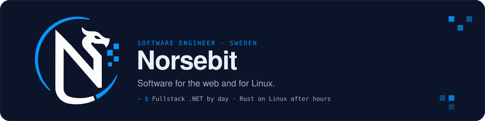

<picture>
  
</picture>

<p align="center">
  <a href="https://www.norsebit.com/"></a>
  <a href="https://www.linkedin.com/in/sebnoren/"></a>
  <a href="https://www.ragetech.se"></a>
</p>

```rust
let norsebit = Developer {
    based_in:  "Sweden",
    day_job:   "Fullstack .NET developer",
    after_dark: "Small native Linux apps in Rust",
    building:  "Sorted — swipe-to-cull photo sorter",
    believes:  ["no telemetry", "no accounts", "one job per app"],
};
```

### Tools of the trade

**Web**

<a href="#"></a>

**Linux & systems**

<a href="#"></a>

**Where it started**

<a href="#"></a>

### Now in the forge

| Project | What it does | Status |
| --- | --- | --- |
| **[Sorted](https://github.com/norse-bit/sorted)** | Cull hundreds of photos in minutes. Swipe right to keep, left to reject. | `in development` |
| **[Ragetech forge](https://github.com/ragetech-forge)** | Self-hosted services and experiments on my own VPS. | `running` |

<details>
<summary><b>Why "Norsebit"?</b></summary>
<br>

**Norse** — from Sweden. **Bit** — the smallest piece of anything digital.
Read it another way, **Nor·Seb·IT**, and it's also my name and my trade.

</details>

<p align="center"><sub>Built in Sweden · Apps released under <a href="https://github.com/ragetech-forge">ragetech-forge</a></sub></p>
